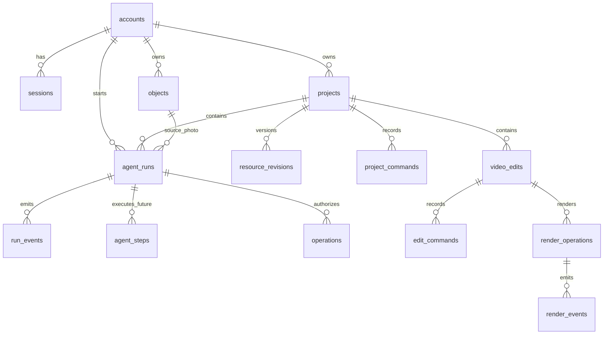

# AI Video Studio 服务端架构：账号、云端 Agent、SSE 与任务恢复

状态：设计稿，供用户审核；本文不授权新增表或迁移现有数据。

## 目标与约束

面试演示版支持桌面、网页、移动端注册登录，共用云项目和分集。用户上传照片并输入提示词，服务端产生可检查的计划；用户确认后，服务端调用可灵，持续返回状态，最终把视频保存到选定分集。模型与可灵密钥仅存在于服务端配置。无支付系统，按账户限制演示生成次数。刷新、断线、重启不能让同一意图重复产生付费提交。画布只存在于桌面和网页，使用同一个任务 API；视频微调另有独立渲染任务。

沿用已批准的“一个云端权威服务＋清晰分层的后台 worker”方案。备选方案是各端独立运行，无法保持同一任务和费用记录；一开始拆成多个微服务会增加部署与分布式事务成本。演示阶段可将 API 与 worker 部署在一个进程中，但代码和数据库责任分开。

## 现在有多少张表

`apps/api/src/db.ts` 当前建 **13 张表**。其中注册、项目、照片生成视频主链路是 **7 张**；项目同步是 **2 张**；三端视频微调是 **4 张**。如果 Agent 从目前的单生成步骤发展为可持久恢复的逐节点运行，建议加 **1 张 `agent_steps`**，合计 **14 张**。`agent_steps` 是建议迁移，当前尚未实现。视频编辑的 4 张表属于另一插件，不能算成注册和生成的必要表。

| 范围 | 表 | 作用与关键约束 |
| --- | --- | --- |
| 身份 | `accounts` | 账号、密码哈希、演示额度计数；`email` 唯一。 |
| 身份 | `sessions` | 7 天会话，只存令牌摘要；`account_id → accounts.id`。 |
| 项目 | `projects` | 项目所有者、标题、修订号、当前文档；`owner_id → accounts.id`。文档内暂存分集与镜头。 |
| 媒体 | `objects` | 上传照片和生成视频的不可变对象元数据；`owner_id → accounts.id`，同一账号的 SHA-256 唯一。字节存文件或对象存储。 |
| Agent | `agent_runs` | 一次用户意图、输入、目标分集、计划、状态；`(owner_id, client_request_id)` 唯一，同 ID 不同输入返回冲突。 |
| Agent | `run_events` | 运行状态的持久事件；`(run_id, seq)` 主键，供 SSE 与断线补读。 |
| 外部操作 | `operations` | 一次确认后的可灵提交账本；`external_task_id` 唯一，并记录 `remote_task_id` 和未知状态。当前 `run_id` 唯一，只支持每次运行一个付费操作。 |
| 同步 | `resource_revisions` | 分集、素材、人物、画布的单资源版本，用于并发冲突判断。 |
| 同步 | `project_commands` | 客户端保存命令的幂等账本，`(project_id, command_id)` 唯一。 |
| 微调 | `video_edits` | 原视频引用、版本化编辑配方和当前预览。 |
| 微调 | `edit_commands` | 每条编辑命令的幂等记录。 |
| 微调 | `render_operations` | 每版配方一个云端渲染任务，`(edit_id, recipe_revision)` 唯一。 |
| 微调 | `render_events` | 云端渲染进度的持久事件。 |
| 建议新增 | `agent_steps` | 每个节点／工具步骤的输入快照、输出、状态、顺序、重试信息；`run_id → agent_runs.id`，`(run_id, step_key)` 唯一。 |

## 关联关系

当前实际数据库中 `agent_runs → operations` 是至多 1 条；图中的 1 对多是逐节点 Agent 的目标模型。增加 `agent_steps` 时，让每个有副作用的 `operations.step_id` 指向一个步骤，并把 `operations.run_id UNIQUE` 迁移为 `UNIQUE(step_id, operation_key)`。纯计划／验证步骤可只写 `agent_steps`，无需外部操作行。分集和镜头暂在 `projects.document_json` 中，靠项目所有权与资源版本约束；若后续要跨项目查询、多人协作或复杂筛选，再拆成独立的 `episodes`、`shots` 表，演示版先不增加。

## 请求、执行与返回

1. **注册登录**：`POST /auth/register` 校验邮箱和密码，使用慢哈希存密码，创建会话；`POST /auth/login`、`GET /auth/me`、`POST /auth/logout` 使用 HttpOnly Cookie。所有项目、对象、任务和事件读取都在服务端按当前账号授权。开放注册还应有请求频率、上传大小与数量限制。
2. **创建意图**：客户端生成稳定 `clientRequestId`，`POST /projects/:id/runs`。服务端验证照片和分集属于当前用户，保存输入与计划，再返回 `runId`、`planHash`、`waiting_approval`。同 ID 同输入重试返回原运行；不同输入拒绝。当前代码的计划由确定性 `planImageVideo` 生成，尚未调用大模型；接入云端模型时，应把模型版本、运行开始时的画布图和各步输入快照存入运行／步骤记录，运行期间修改画布不改变已有任务。模型输出必须通过受控工具参数校验。
3. **确认执行**：`POST /runs/:id/approve` 携带稳定 `approvalId` 与 `planHash`。同一数据库事务内再次校验计划、原子预留演示额度，插入 `operations`，写运行事件。相同确认重试返回原操作，不能二次预留。
4. **后台 worker**：只领取已持久化的待提交操作，先把状态写为 `submitting`，再发唯一一次供应商 POST；保存供应商任务 ID 后只查询原任务。若 POST 回包丢失，进入 `unknown`，先通过已保存的外部关联 ID 核对，不能盲目再次 POST。[可灵新版接口文档](https://kling.ai/document-api/api/video/2-5-turbo)说明 `external_task_id` 可用于查询，[任务查询文档](https://kling.ai/document-api/apiReference/model/imageToVideo)给出 `external_task_ids` 参数；正式付费前仍需用当前账户完成一次受控联调。若未来更换的供应商不能按外部 ID 查询，保持待人工核对，不能承诺自动恢复。成功后在一个事务内登记视频对象、写入目标分集、结算额度、更新状态并追加事件；明确失败时按实际计费规则处理预留额度。
5. **实时反馈**：`GET /runs/:id/events` 返回 `text/event-stream`，每条事件有递增 `id: seq`、`event: state`、JSON `data`。先从 `run_events` 补发 `seq > Last-Event-ID`，再推送新事件并定期发心跳。浏览器用 `EventSource` 自动重连；桌面可复用 SSE 客户端；移动端可用 SSE，网络或后台受限时用 `GET /runs/:id` 按间隔兜底。SSE 只传状态和结果引用，视频通过受权对象接口获取。
6. **恢复**：任一客户端重新打开项目时先查 `/projects/:id/runs` 和任务快照，再从已见事件序号继续订阅。SSE 连接断开不取消 worker，重连不创建新运行。用户明确发起新意图才生成新的 `clientRequestId`。

## 为什么这样拆

- `agent_runs` 是用户请求的身份，`operations` 是会产生外部费用的身份，`run_events` 是可重放的反馈；三者生命周期不同，分开后才能分别保证请求幂等、外部调用只提交一次和断线续看。
- 会话和所有权在服务端判断，三端共享同一套账号隔离；密钥不进入客户端、项目 JSON 或事件流。
- 媒体对象不可变，生成结果与后续编辑版本能并存；项目只保存引用，不让重渲染覆盖原文件或已排入时间线的版本。
- `resource_revisions` 和命令表支持桌面／网页同时修改时发现冲突；演示版无需先把所有项目数据正规化成很多表。
- `agent_steps` 在首个单步骤闭环没有必要，但逐节点工作流若要显示每一步和重启续跑，就必须有持久的步骤身份；不能仅靠 SSE 内存消息。

## 当前实现与下一步差距

现有 API 已有注册登录、主链路 7 表、幂等确认、worker 恢复、网页 SSE 和持久事件；桌面与移动端目前用周期查询反馈，渲染事件目前是普通 JSON 查询。当前 Agent 计划是规则函数，不是真正的模型调用；`operations` 当前限制每次运行一个付费操作。SSE 服务端每连接每秒查一次 SQLite，适合演示，不适合大量并发。要兑现逐节点云端 Agent，下一步先增 `agent_steps` 与步骤状态机，再把供应商操作关联到步骤、接入受控模型调用、统一三端 SSE 与兜底查询。若将来多实例部署，数据库迁移到 PostgreSQL，媒体放对象存储，worker 使用数据库租约或队列，SSE 使用通知层唤醒；这些不属于面试版首期。
